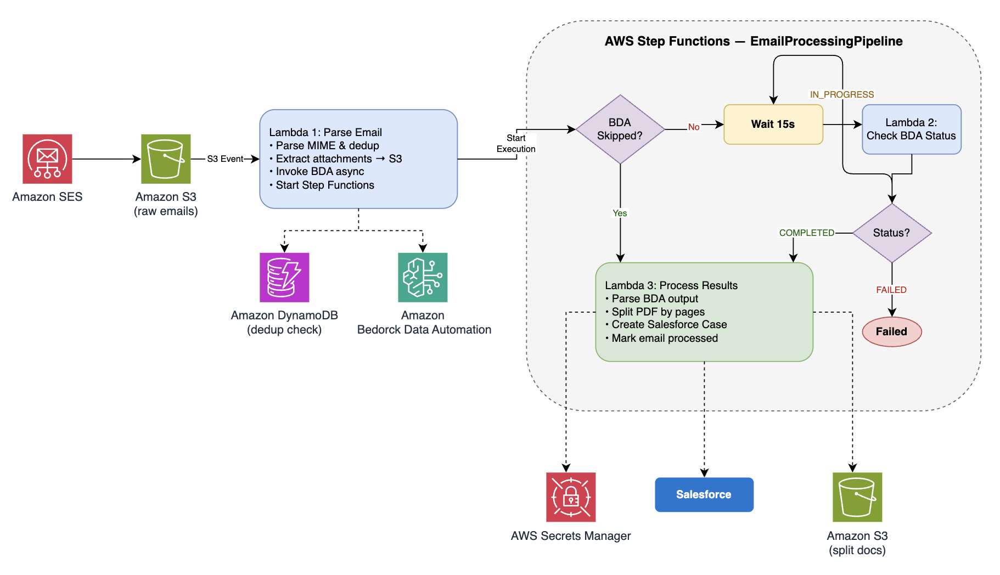

# Automating Insurance Document Intake: Email Processing with Amazon Bedrock Data Automation and Salesforce

This sample demonstrates how insurance carriers can build a serverless pipeline that automatically processes inbound broker emails, splits multi-document PDF attachments (annuity applications, life insurance applications) into individual classified documents using Amazon Bedrock Data Automation (BDA), and creates Salesforce Cases with the documents attached. Built-in deduplication ensures that emails already processed are silently skipped, preventing duplicate Cases and maintaining a clean audit trail for regulatory compliance.

## Architecture




**Services used:**
- Amazon S3 — stores emails, attachments, and split documents; triggers processing
- AWS Lambda — three functions (parse/start, check BDA status, process results)
- AWS Step Functions — orchestrates BDA polling with native Wait states 
- Amazon Bedrock Data Automation — AI-powered document splitting and classification
- Amazon DynamoDB — deduplication registry with TTL
- AWS Secrets Manager — securely stores Salesforce credentials
- Salesforce Composite REST API — atomically creates Cases with attached documents

## How It Works

1. A raw email file (`.eml`) is uploaded to an S3 bucket under the `raw-emails/` prefix
2. An S3 event notification triggers **Lambda 1 (Parse Email)**
3. Lambda 1 parses the MIME email, checks DynamoDB for duplicates, extracts attachments to S3, and invokes BDA async
4. Lambda 1 starts a **Step Functions** execution with the BDA invocation details
5. **Step Functions** handles the async wait:
   - If BDA was skipped (no PDFs or not configured) → go directly to Process Results
   - Otherwise → **Wait 15s** → **Lambda 2 (Check Status)** → loop until complete
6. **Lambda 3 (Process Results)** — parses BDA output, physically splits the PDF, creates Salesforce Case via Composite API, and marks the email as processed

> **Note:** This sample simulates email arrival by uploading `.eml` files directly to S3. In production, Amazon SES can be configured to receive inbound emails and deposit them in S3 automatically — no code changes required.

## Prerequisites

- AWS account with access to Amazon Bedrock (us-east-1 recommended)
- AWS CLI configured with appropriate credentials
- AWS CDK v2 (`npm install -g aws-cdk`)
- Python 3.11+
- A Salesforce org (free [Developer Edition](https://developer.salesforce.com/signup) works)
- OpenSSL (for generating Salesforce authentication certificates)

## Project Structure

```
.
├── README.md
├── LICENSE
├── CODE_OF_CONDUCT.md
├── CONTRIBUTING.md
├── lambda/
│   ├── parse_email/                # Lambda 1 — parse, dedup, extract, invoke BDA, start SFN
│   │   ├── handler.py
│   │   └── requirements.txt
│   ├── check_bda_status/           # Lambda 2 — lightweight BDA status poll
│   │   ├── handler.py
│   │   └── requirements.txt
│   └── process_results/            # Lambda 3 — parse BDA output, split PDF, Salesforce
│       ├── handler.py
│       └── requirements.txt
├── infra/
│   ├── app.py                      # CDK app entry point
│   ├── stack.py                    # CDK stack (S3, Lambdas, Step Functions, DynamoDB, IAM)
│   ├── cdk.json
│   └── requirements.txt            # CDK dependencies
├── samples/
│   ├── test_raw_email.eml          # Pre-built test email with PDF attachment
│   ├── annuity_policy_application.pdf   # Standalone annuity app (for blueprint creation)
│   ├── life_insurance_application.pdf   # Standalone life insurance app (for blueprint creation)
│   └── combined_no_cover.pdf       # Combined PDF for testing BDA splitting
└── docs/
    ├── architecture_diagram.png
```

> **Note:** The PDF files and test emails in `samples/` contain synthetic data generated for testing purposes and do not represent real individuals.

## Deployment

### Step 1: Deploy Infrastructure

```bash
cd infra
python3 -m venv .venv
source .venv/bin/activate
pip install -r requirements.txt

cdk bootstrap   # First time only
cdk deploy
```

Note the outputs:
- `BucketName` — your S3 bucket
- `ParseEmailFunctionName` — the trigger function
- `StateMachineArn` — the Step Functions state machine
- `DedupTableName` — DynamoDB table

### Step 2: Configure Bedrock Data Automation

#### 2a: Create Blueprints (AWS Console)

1. Go to **Amazon Bedrock** → **Data Automation** → **Custom output setup**
2. Click **"Create Blueprint"**
3. Upload `samples/annuity_policy_application.pdf` as a sample document
4. Enter this blueprint prompt:

```
Extract the following from this annuity policy application:
- Full name of the annuity applicant
- Date of birth of the applicant
- Type of annuity selected (Fixed, Variable, Indexed, Immediate)
- Initial premium or funding amount
- Name of the primary beneficiary
- Policy or application number if present
- Whether the applicant signature is present on the form
```

5. Click **"Generate blueprint"**
6. Name it: `AnnuityPolicyApplication`
7. Save the blueprint

Repeat for Life Insurance:

1. Click **"Create Blueprint"** again
2. Upload `samples/life_insurance_application.pdf`
3. Enter this blueprint prompt:

```
Extract the following from this life insurance application:
- Full name of the insured/applicant
- Date of birth of the applicant
- Type of life insurance (Term, Whole Life, Universal, Variable)
- Coverage amount (face value or death benefit amount)
- Name of the primary beneficiary
- Relationship of beneficiary to insured
- Policy or application reference number
- Whether the applicant signature is present
```

4. Click **"Generate blueprint"**
5. Name it: `LifeInsuranceApplication`
6. Save the blueprint

#### 2b: Create a Project (AWS Console)

1. In **Data Automation** → click **"Create project"**
2. Name it: `InsuranceEmailDocumentProcessor`
3. Click **"Create project"**
4. Go to the **Custom output** tab → **Add blueprint** → add both blueprints you created

#### 2c: Enable Document Splitting (CLI — not available in console)

Document splitting must be enabled via CLI:

```bash
aws bedrock-data-automation update-data-automation-project \
    --project-arn "<YOUR_PROJECT_ARN>" \
    --override-configuration '{"document": {"splitter": {"state": "ENABLED"}}}'
```

Get your project ARN from the project details page in the console.

#### 2d: Update Lambda with the Project ARN

```bash
aws lambda update-function-configuration \
    --function-name InvokeBDA \
    --environment "Variables={
        BUCKET_NAME=$(aws cloudformation describe-stacks --stack-name EmailProcessingStack \
            --query \"Stacks[0].Outputs[?OutputKey=='BucketName'].OutputValue\" --output text),
        BDA_PROJECT_ARN=<YOUR_PROJECT_ARN>
    }"
```

### Step 3: Configure Salesforce Integration

**Generate a certificate pair:**

```bash
openssl req -x509 -nodes -days 3650 \
    -newkey rsa:2048 \
    -keyout salesforce_private_key.pem \
    -out salesforce_certificate.crt \
    -subj "/CN=AWS Email Processing/O=MyCompany"
```

**Create an External Client App in Salesforce:**
1. Setup → App Manager → New External Client App
2. Enable OAuth → add scopes: `api`, `refresh_token, offline_access`
3. Enable JWT Bearer Flow → upload `salesforce_certificate.crt`
4. Pre-authorize your user profile under Policies tab

**Store credentials in Secrets Manager:**

```bash
aws secretsmanager update-secret \
    --secret-id salesforce/integration \
    --secret-string "$(python3 -c "
import json
private_key = open('salesforce_private_key.pem').read()
print(json.dumps({
    'consumer_key': '<YOUR_CONSUMER_KEY>',
    'service_user_email': '<YOUR_SF_USERNAME>',
    'private_key': private_key
}))
")"
```

### Step 4: Test End-to-End

Upload the sample email to trigger the pipeline:

```bash
BUCKET=$(aws cloudformation describe-stacks --stack-name EmailProcessingStack \
    --query "Stacks[0].Outputs[?OutputKey=='BucketName'].OutputValue" --output text)

aws s3 cp samples/test_raw_email.eml s3://$BUCKET/raw-emails/test_email.eml
```

Verify in Salesforce:
- Open Cases → you should see a new Case with split, classified documents attached

## Adding SES for Production (Optional)

To receive real emails instead of manual S3 uploads:

1. Verify your domain in Amazon SES
2. Add MX record to DNS pointing to SES
3. Create a receipt rule that delivers to `s3://<bucket>/raw-emails/`
4. Activate the rule set

## Production Considerations:

1.Replace RemovalPolicy.DESTROY with RETAIN
2.Upgrade to SSE-KMS for PII workloads
3.Add Lambda reserved concurrency + DLQ
4.Deploy Lambda in VPC for network isolation
5.Mask PII in CloudWatch Logs

## Cleanup

```bash
cd infra
cdk destroy
```

This removes the S3 bucket (and all objects), DynamoDB table, Lambda function, and associated IAM roles.

Additionally, delete the BDA resources created manually:

```bash
# Delete the BDA project
aws bedrock-data-automation delete-data-automation-project \
    --project-arn <YOUR_PROJECT_ARN>

# Delete the blueprints
aws bedrock-data-automation delete-blueprint \
    --blueprint-arn <YOUR_ANNUITY_BLUEPRINT_ARN>

aws bedrock-data-automation delete-blueprint \
    --blueprint-arn <YOUR_LIFE_INSURANCE_BLUEPRINT_ARN>
```

Also delete the Secrets Manager secret if no longer needed:

```bash
aws secretsmanager delete-secret \
    --secret-id salesforce/integration \
    --force-delete-without-recovery
```

## Security

See [CONTRIBUTING](CONTRIBUTING.md#security-issue-notifications) for more information.

## License

This library is licensed under the MIT-0 License. See the [LICENSE](LICENSE) file.
